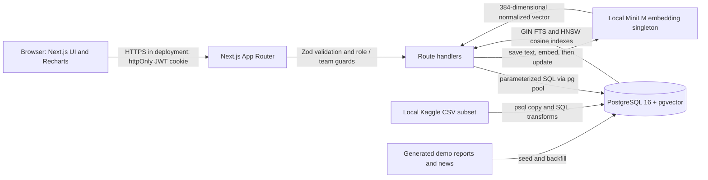

# Architecture

The browser uses the App Router UI and typed API client. Login verifies bcrypt password hashes and sets a signed httpOnly JWT cookie. Middleware and route guards enforce authentication; individual handlers enforce roles and manager team ownership. Zod validates input before parameterized queries use the shared `pg` pool. SQL objects hold integrity rules, team scoring, and analytical views. Audited roster writes set `app.current_user_id` transaction-locally; triggers write old/new records and actor to `audit_log`.

Report and news writes commit text first. Application code embeds with the shared local `Xenova/all-MiniLM-L6-v2` model and saves the vector plus metadata; failure leaves the row pending for `npm run embed -- --missing`. The model is loaded once per server process. Updates invalidate stale embeddings in database triggers. Hybrid report search combines vector ordering with relational filters; keyword search uses PostgreSQL full-text search. [API contracts](api.md), [vector design](vector-search.md), and [data provenance](data-sources.md) describe the details.

The import pipeline loads the documented local NBA and combine CSV subset through staging tables and transforms. Generated supporting texts and demo accounts are separate from imported facts. Vitest creates isolated databases; `npm run test:all` also runs API and browser checks using temporary servers and a separate seeded acceptance database. See [test results](test-results.md). Draft and prospect workflows are future extensions.
