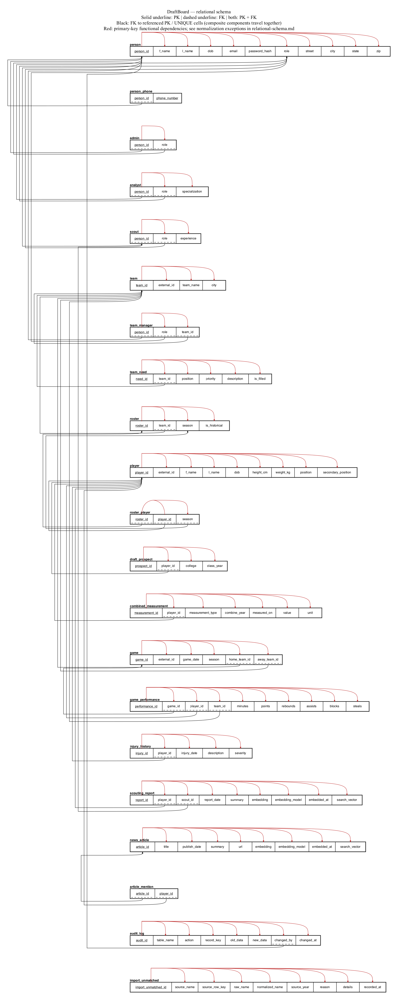
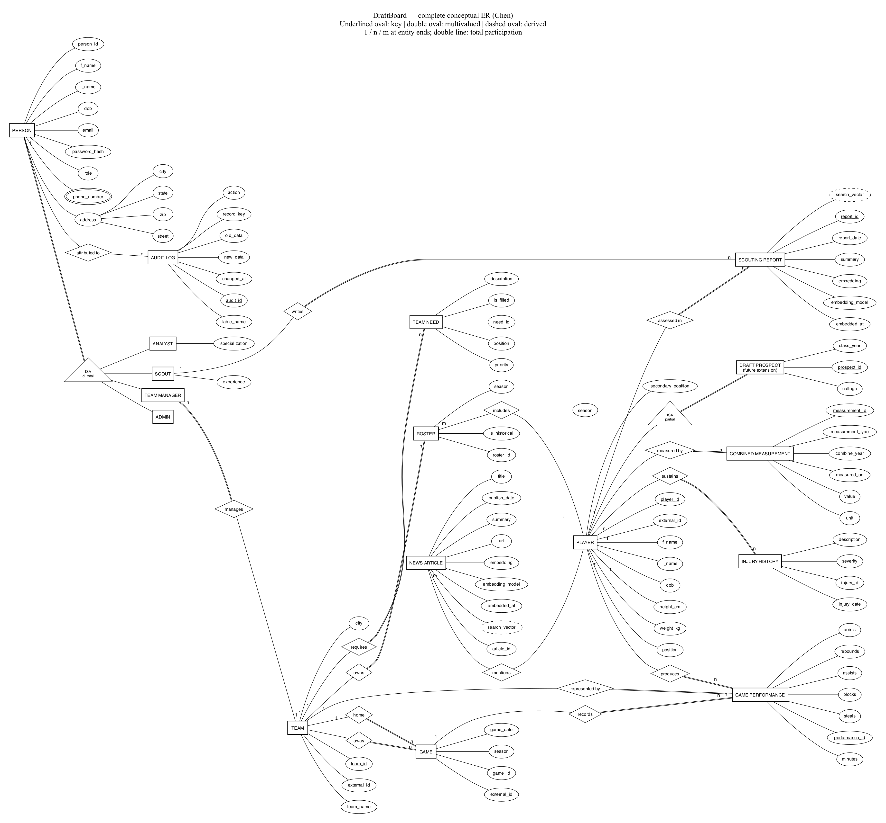

# DraftBoard relational schema



[Zoomable relational SVG](relational-schema.svg) · [DOT source](diagrams/relational-schema.dot)



[Zoomable Chen SVG](er-diagram.svg) · [DOT source](diagrams/er-chen.dot)

The full conceptual diagram is a large-format overview. Use these Chen detail views for reading or presenting attributes:

- [People & Teams PNG](er-people-teams.png) / [SVG](er-people-teams.svg)
- [Players & Games PNG](er-players-games.png) / [SVG](er-players-games.svg)
- [Reports & News PNG](er-reports-news.png) / [SVG](er-reports-news.svg)

Regenerate all PNGs and SVGs with `npm run diagrams`. Graphviz is the only rendering prerequisite (`brew install graphviz` on macOS). Edit the checked-in DOT sources in `docs/diagrams/`; the relational source uses fixed coordinates and explicitly routed edges to keep each table on one row. Keep cell widths, positions and edge routes in sync when editing it.

Chen notation uses rectangles for entities, diamonds for relationships, ovals for attributes, underlined identifiers, a double oval for phone numbers and dashed ovals for generated search vectors. Cardinalities appear at the entity ends; double lines indicate mandatory participation. PERSON specialization is disjoint and total. PLAYER specialization into DRAFT PROSPECT is partial and reserved for future work. Subtypes inherit their conceptual identifier; the relational diagram shows their implementing keys explicitly. The `import_unmatched` import log is included in the relational schema but omitted from the Chen diagrams because it is not a domain entity. Audit attribution is optional because scripts and deleted users may leave `changed_by` NULL; `record_key` is not a foreign key.

The relational diagram uses solid underlining for PKs and a second, dashed underline for FKs (both appear when applicable). Black arrows terminate at the actual referenced cells, including the `role` and `season` components of composite UNIQUE targets. Red arrows above each row show **the entire primary key** determining its non-PK attributes; joined stems identify composite determinants. They are not a claim that these are the only FDs or that a key arrow alone proves 3NF. See the exceptions below.

## Relations and foreign keys

Names and columns match `db/postgres/01_schema.sql`, plus the durable `import_unmatched` table from `db/import/00_staging.sql`. Raw `stg_*` loading tables are outside the application model. The optional `team.abbreviation` ALTER demonstration is outside this base-schema snapshot. Underlined attributes form the PK; **[FK]** marks each foreign-key component. Nullable UNIQUE attributes are alternate identifiers only for non-NULL values.

**TEAM**(<u>team_id</u>, external_id, team_name, city)

**PERSON**(<u>person_id</u>, f_name, l_name, dob, email, password_hash, role, street, city, state, zip)

**PERSON_PHONE**(<u>person_id</u> **[FK]**, <u>phone_number</u>)

- FK `(person_id)` → `person(person_id)`.

**SCOUT**(<u>person_id</u> **[FK]**, role **[FK]**, experience)

- FK `(person_id, role)` → `person(person_id, role)`.

**ANALYST**(<u>person_id</u> **[FK]**, role **[FK]**, specialization)

- FK `(person_id, role)` → `person(person_id, role)`.

**TEAM_MANAGER**(<u>person_id</u> **[FK]**, role **[FK]**, team_id **[FK]**)

- FK `(person_id, role)` → `person(person_id, role)`.
- FK `(team_id)` → `team(team_id)`.

**ADMIN**(<u>person_id</u> **[FK]**, role **[FK]**)

- FK `(person_id, role)` → `person(person_id, role)`.

**TEAM_NEED**(<u>need_id</u>, team_id **[FK]**, position, priority, description, is_filled)

- FK `(team_id)` → `team(team_id)`.

**ROSTER**(<u>roster_id</u>, team_id **[FK]**, season, is_historical)

- FK `(team_id)` → `team(team_id)`.

**PLAYER**(<u>player_id</u>, external_id, f_name, l_name, dob, height_cm, weight_kg, position, secondary_position)

**ROSTER_PLAYER**(<u>roster_id</u> **[FK]**, <u>player_id</u> **[FK]**, season **[FK]**)

- FK `(roster_id, season)` → `roster(roster_id, season)`.
- FK `(player_id)` → `player(player_id)`.

**DRAFT_PROSPECT**(<u>prospect_id</u>, player_id **[FK]**, college, class_year)

- FK `(player_id)` → `player(player_id)`.

**COMBINED_MEASUREMENT**(<u>measurement_id</u>, player_id **[FK]**, measurement_type, combine_year, measured_on, value, unit)

- FK `(player_id)` → `player(player_id)`.

**SCOUTING_REPORT**(<u>report_id</u>, player_id **[FK]**, scout_id **[FK]**, report_date, summary, embedding, embedding_model, embedded_at, search_vector)

- FK `(player_id)` → `player(player_id)`.
- FK `(scout_id)` → `scout(person_id)`.

**INJURY_HISTORY**(<u>injury_id</u>, player_id **[FK]**, injury_date, description, severity)

- FK `(player_id)` → `player(player_id)`.

**GAME**(<u>game_id</u>, external_id, game_date, season, home_team_id **[FK]**, away_team_id **[FK]**)

- FK `(home_team_id)` → `team(team_id)`.
- FK `(away_team_id)` → `team(team_id)`.

**GAME_PERFORMANCE**(<u>performance_id</u>, game_id **[FK]**, player_id **[FK]**, team_id **[FK]**, minutes, points, rebounds, assists, blocks, steals)

- FK `(game_id)` → `game(game_id)`.
- FK `(player_id)` → `player(player_id)`.
- FK `(team_id)` → `team(team_id)`.

**NEWS_ARTICLE**(<u>article_id</u>, title, publish_date, summary, url, embedding, embedding_model, embedded_at, search_vector)

**ARTICLE_MENTION**(<u>article_id</u> **[FK]**, <u>player_id</u> **[FK]**)

- FK `(article_id)` → `news_article(article_id)`.
- FK `(player_id)` → `player(player_id)`.

**AUDIT_LOG**(<u>audit_id</u>, table_name, action, record_key, old_data, new_data, changed_by **[FK]**, changed_at)

- FK `(changed_by)` → `person(person_id)`.

**IMPORT_UNMATCHED**(<u>import_unmatched_id</u>, source_name, source_row_key, raw_name, normalized_name, source_year, reason, details, recorded_at)

## ER -> relational mapping

- **ISA:** PERSON maps to `person` plus one shared-PK subtype table. Composite `(person_id, role)` FKs and fixed subtype roles prevent mismatched membership; deferred subtype checks require exactly the matching subtype at commit. DRAFT PROSPECT uses a surrogate `prospect_id` plus a NOT NULL UNIQUE `player_id` FK; this is a partial specialization and is not populated in current scouting workflows.
- **Multivalued phone:** the double oval becomes `person_phone(person_id, phone_number)` with a composite PK.
- **Composite address:** the single address oval is flattened into `street`, `city`, `state`, `zip` in `person`; there is no duplicate city or separate address row.
- **M:N:** Roster–Player becomes `roster_player`, with relationship attribute `season`; News Article–Player becomes `article_mention`. Composite PKs prevent duplicate pairs. One roster per player-season is enforced by the additional UNIQUE key. A traded player's per-game team remains in `game_performance.team_id`.
- **1:N:** the FK goes on the many side. Each performance requires one game, player and team; each report requires a player and scout. Mandatory FKs implement total participation on these sides. Game's two team relationships become distinct `home_team_id` and `away_team_id` FKs. A manager must manage a team, but the schema allows multiple managers per team.
- **Search and auditing:** news and its mentions are relational tables in PostgreSQL. `vector(384)` and generated `tsvector` columns support similarity and keyword retrieval. Audit rows preserve old/new snapshots; only `changed_by` is an enforced entity reference.

## Normalization (3NF)

An FD `K → rest` below means the listed determinant determines every other attribute in that relation. A relation is in 3NF when every nontrivial FD has a superkey determinant or a prime dependent attribute (one belonging to a candidate key). Primary-key arrows alone cannot establish this. These are the key FDs and intended domain assumptions:

| Table | Key functional dependencies |
|---|---|
| `team` | `(team_id) → rest`; team_name → rest; external_id → rest when non-NULL |
| `person` | `(person_id) → rest`; email → rest |
| `person_phone` | `(person_id, phone_number) → all attributes (no non-key attributes)` |
| `scout` | `(person_id) → rest` |
| `analyst` | `(person_id) → rest` |
| `team_manager` | `(person_id) → rest` |
| `admin` | `(person_id) → rest` |
| `team_need` | `(need_id) → rest` |
| `roster` | `(roster_id) → rest`; (team_id, season) → rest |
| `player` | `(player_id) → rest`; external_id → rest when non-NULL |
| `roster_player` | `(roster_id, player_id) → rest`; (player_id, season) → roster_id; roster_id → season |
| `draft_prospect` | `(prospect_id) → rest`; player_id → rest |
| `combined_measurement` | `(measurement_id) → rest`; (player_id, measurement_type, combine_year) → rest |
| `scouting_report` | `(report_id) → rest` |
| `injury_history` | `(injury_id) → rest` |
| `game` | `(game_id) → rest`; external_id → rest when non-NULL |
| `game_performance` | `(performance_id) → rest`; (game_id, player_id) → rest |
| `news_article` | `(article_id) → rest`; url → rest when non-NULL |
| `article_mention` | `(article_id, player_id) → all attributes (no non-key attributes)` |
| `audit_log` | `(audit_id) → rest` |
| `import_unmatched` | `(import_unmatched_id) → rest`; (source_name, source_row_key) → rest |

For ordinary entity tables, the single-column PK has no proper nonempty subset, so there is no partial dependency on that PK. The natural composite keys in measurements, performances and import diagnostics describe one complete observation or source row. Names, addresses and descriptions are not assumed to be unique determinants. There is no assumed `zip → city/state` FD: these are user-entered address fields, not a postal reference dataset. Junctions `person_phone` and `article_mention` have only key attributes and no non-key partial or transitive dependencies.

The implemented schema includes explicit qualifications; it would be inaccurate to claim that **every stored table is strictly in 3NF**:

- **Person role:** `person_id → role` is an intentional duplication of subtype membership for one-lookup authentication. It does not itself violate local 3NF in `person`, but consistency across relations needs the deferred constraint triggers. Each subtype also has the constant FD `∅ → role`; storing that non-key constant is a formal normalization exception required by the composite-FK enforcement design.
- **Roster season:** `roster_id → season` is a partial dependency on the composite primary key and repeats a parent value. Both `season` and `roster_id` are prime because candidate keys are `(roster_id, player_id)` and `(player_id, season)`. Thus this FD is permitted by 3NF, although it violates BCNF. It is kept deliberately so `UNIQUE(player_id, season)` enforces one roster per player per season; the composite FK to `roster(roster_id, season)` keeps the repeated season consistent. There is no non-prime attribute with a partial dependency in this junction.
- **Measurement units:** under the canonical import convention, `measurement_type → unit` (for example, wingspan uses cm). This is a semantic transitive dependency and an intentional stored-unit exception to strict 3NF; `01_schema.sql` does not itself enforce the canonical-unit FD. Separating a measurement-type/unit lookup would normalize it, but this documentation change does not alter the fixed schema.
- **Generated search vectors:** `summary → search_vector` in reports and `(title, summary) → search_vector` in news are deliberate materialized derivations for GIN indexing. They are formal non-key dependencies in the physical tables. PostgreSQL computes them, preventing update anomalies. Embedding metadata records model and processing time; text alone is not asserted to determine those values.
- **Audit snapshots:** old/new JSONB values are immutable event payloads, not independent relational facts to decompose. `record_key` is not unique across events. Import diagnostics similarly preserve the source snapshot, with `(source_name, source_row_key)` identifying one diagnostic record. The import computes `normalized_name` from `raw_name`; that stored derivation is another semantic non-key dependency, retained for traceable matching diagnostics rather than a claim of strict physical 3NF.

The remaining ordinary relations have no declared non-key-to-non-key dependencies under these assumptions. Nullable external IDs and URLs use PostgreSQL UNIQUE semantics (multiple NULLs allowed), so they are not unconditional candidate keys. The diagram preserves the actual schema and its intentional exceptions rather than silently redesigning it to support a stronger normal-form claim.

## DDL demonstrations

`02_alter_demo.sql` adds the optional team abbreviation, adds its format check and index, and creates/drops a scratch table and index. The statements are repeatable so the full Phase 1 sequence can be run twice after a reset.

## Running the Phase 1 sequence

PowerShell scripts read PostgreSQL connection settings from the normal `psql` environment (`PGHOST`, `PGPORT`, `PGUSER`, `PGPASSWORD`, and `PGDATABASE`):

```powershell
./scripts/reset-db.ps1
./scripts/apply-phase1.ps1
./scripts/apply-phase1.ps1
./scripts/reset-db.ps1
./scripts/apply-phase1.ps1
```

`phase1-check.ps1` performs the complete acceptance sequence in one command. It uses `ON_ERROR_STOP=1`, so any SQL error stops the check immediately.

`draft_prospect` and its matching/procedure objects are retained only for a future draft extension. Active Team Match ranks existing NBA players using `fn_match_players_for_team`; see the [data dictionary](data-dictionary.md). `import_unmatched` is an independent import diagnostics table, not an entity linked to a guessed player.

## Diagram verification

On 2026-11-02, `npm run diagrams` rendered all five PNG/SVG pairs with Graphviz 16.1.0. Both full PNGs and all three Chen detail views were opened for visual inspection; crowded cardinality labels and the future-extension annotation were repositioned, then the full diagrams and Players & Games view were checked again. A source comparison verified all 21 relations, columns in SQL order, and all 28 FK component arrows against the DDL. `node --check scripts/render-diagrams.cjs` and `git diff --check` passed. No database or application behavior changed.
